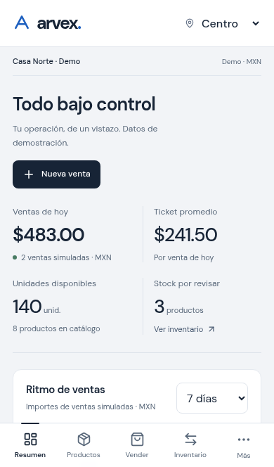
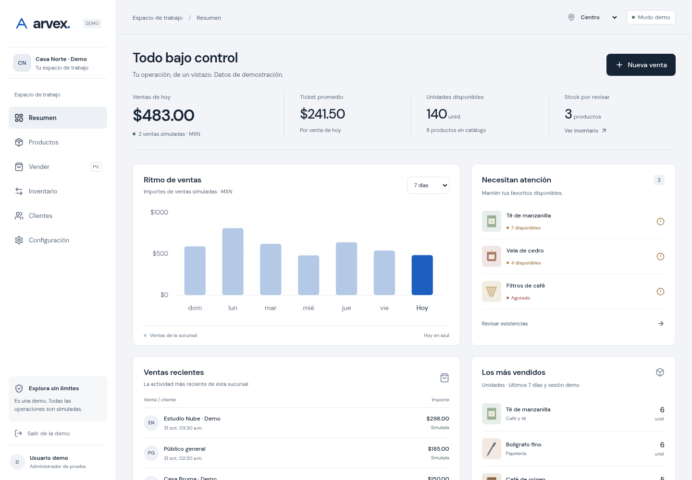
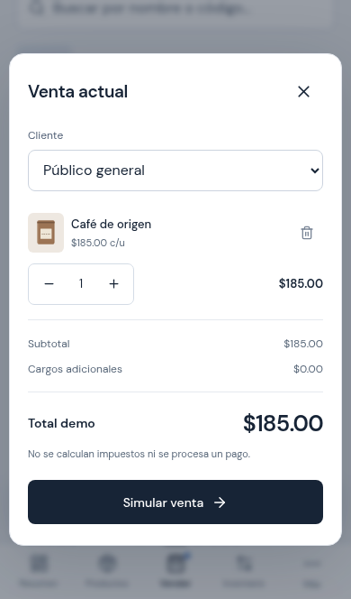
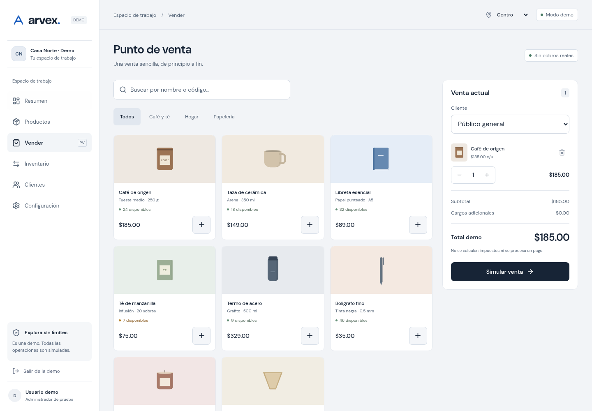

# Resultado de validación de la demo

- `npm test`: **6 pruebas aprobadas**. Importes en centavos, venta/stock/movimientos, cantidades y productos inválidos, exceso de existencias, separación por sucursal, indicadores por fecha, relectura y reconciliación del saldo con movimientos.
- `npm run test:e2e`: **17 pruebas aprobadas**, ninguna omitida, en Chromium con emulación móvil y vistas adicionales de tablet/escritorio.
- `npm run build`: **aprobado** (Vite 7.3.7). JS principal 273.65 kB / 84.51 kB gzip; CSS 42.16 kB / 9.12 kB gzip. Tipografía local.
- `npm run format:check`: aprobado.
- `npm audit --omit=dev --audit-level=high`: **0 vulnerabilidades reportadas en dependencias de ejecución**. No equivale a auditoría de seguridad del producto.
- Compilación servida con `vite preview`: HTTP 200, venta/ticket correctos y cero errores JavaScript en Chromium móvil y escritorio.

## Navegador y accesibilidad

La suite verifica venta completa con recarga, categorías/búsqueda/estado vacío, movimientos válidos e inválidos, carrito pendiente al cambiar sucursal, ficha de cliente, configuración, restablecimiento con confirmación, agotados, cantidades, teclado/Escape y devolución de foco, enlace para saltar al contenido, cambios sin guardar, datos locales corruptos, almacenamiento bloqueado y sincronización entre dos pestañas.

En 320, 390, 768 y 1440 px se revisaron resumen, catálogo, punto de venta e inventario sin overflow horizontal y sin violaciones axe en reglas WCAG A/AA seleccionadas. También se escanearon acceso, clientes, configuración y diálogo de movimientos. La revisión automática no certifica accesibilidad completa. Se corrigieron los contrastes detectados sin excluir reglas del analizador.

La revisión independiente de código detectó y permitió corregir: skip-link que alteraba la ruta, borradores de configuración perdidos al navegar, persistencia obsoleta entre pestañas y navegación activa que quitaba protección del formulario. Cada caso tiene regresión en la suite.

## Diseño

Impeccable `context` se ejecutó con motor y caché temporal. El detector final emitió **dos advertencias**, revisadas manualmente: borde triangular de la punta del bolígrafo CSS y franja del lomo de la libreta CSS. Ambas pertenecen a representaciones esquemáticas de productos, no a bordes de tarjetas o paneles; se conservaron. No hay hooks activos.

Taste aportó la dirección de app `achromatic-ledger`. Se revisaron capturas renderizadas de móvil y escritorio. Emil y mobile-native se aplicaron a interacción inmediata, controles, foco, safe areas, viewport dinámico, tamaño de entradas y reduced-motion. No se instalaron librerías de animación ni imágenes externas.

Capturas de la compilación:

| iPhone emulado | Escritorio |
| --- | --- |
|  |  |
|  |  |

## Pendiente externo

No se ha probado en un iPhone físico/Safari ni se ha generado una URL HTTPS pública: no hay conexión o credencial de Vercel disponible. Ver docs/DEMO.md para el despliegue Preview sin producción. El uso real de teclado virtual, orientación, safe areas y Safari debe validarse con esa URL en el teléfono.

La demo no ofrece autenticación ni aislamiento de empresas en servidor, no calcula impuestos, no factura, no cobra y no sincroniza dispositivos. El estado del navegador no sustituye una base de datos.
